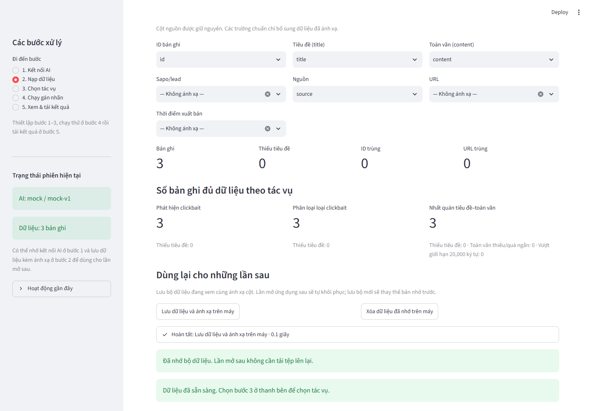

# KHDL Auto Labeler 0.2.0



Công cụ Streamlit chạy trên máy cá nhân để tạo **pseudo-label** cho dữ liệu clickbait tiếng Việt. Ứng dụng hỗ trợ Gemini, OpenAI và mock provider ngoại tuyến; nhận CSV, XLSX, JSONL; giữ nguyên dữ liệu và nhãn nguồn; lưu checkpoint SQLite để tiếp tục job; và xuất bộ kết quả có provenance.

Pseudo-label do LLM tạo ra không thay thế gold label, human review hoặc đánh giá mô hình.

Prompt mặc định hiện là **v2**: gán clickbait theo thủ pháp rõ rệt thay vì từ khóa; đọc sapo như ngữ cảnh bổ sung khi có thân bài; đối chiếu các khẳng định, thời gian và phạm vi của tiêu đề. Các trường hợp Detection=1 nhưng Type rỗng, hoặc Type có `misleading` nhưng Consistency=`consistent`, được đưa vào hàng chờ rà soát kể cả khi confidence cao. Nhãn không bị tự sửa để ép khớp giữa các tác vụ.

Type được đánh giá tách phần thủ pháp tiêu đề và phần sai lệch nội dung trong cùng yêu cầu API; phần sau không được xóa thủ pháp tiêu đề đã nhận diện. Consistency kiểm tra độ đầy đủ của thân bài và yêu cầu một đoạn bằng chứng nguyên văn trong `content`. Trường hợp chỉ có ngữ cảnh chung hoặc dữ liệu không đồng bộ được giữ để rà soát, thay vì mặc định bài báo sai.

Muốn áp dụng rubric mới, hãy tạo **job mới**. Job cũ tiếp tục dùng phiên bản prompt đã ghi nhận; kết quả cũ không bị ghi đè. Do kiểm tra kết nối gắn với phiên bản prompt, cần kiểm tra lại model cho v2 ở bước 1 hoặc bước 4.

## Tác vụ

- **Clickbait Detection:** phân loại tiêu đề `0` (Non-clickbait) hoặc `1` (Clickbait).
- **Clickbait Type Classification:** gán nhiều nhãn trong taxonomy `config/taxonomy.yaml`. Chỉ xét `misleading` khi có toàn văn.
- **Title–Content Consistency:** so sánh tiêu đề với toàn văn; thiếu, quá ngắn hoặc bị cắt thì ứng dụng không kết luận như thể đã đọc đủ bài.

Lead/sapo không được xem là toàn văn. Tên cột nguồn và nhãn gốc được giữ nguyên khi xuất.

## Cài đặt và chạy trên Windows

Yêu cầu Python 3.11 trở lên.

Lấy phiên bản ứng dụng có cơ chế gán nhãn v2:

```powershell
git clone --branch feat/auto-labeler-v0.2.0 --single-branch https://github.com/nguyenquanganh102006-beep/clickbait-lens.git
cd clickbait-lens
.\scripts\setup_windows.bat
.\scripts\run_windows.bat
```

Mở <http://127.0.0.1:8501>. Ở bước 3, kiểm tra dòng **Prompt v2**. Cấu hình API key của riêng bạn, kiểm tra model cho các tác vụ cần chạy, ánh xạ `title`, `content` và `lead`/`sapo`, rồi tạo job mới. Xem [hướng dẫn cơ chế v2](docs/LABELING_V2.md) để hiểu điều kiện gán nhãn và rà soát.

Mở nhanh trên Windows: chạy **`CHAY_UNG_DUNG.bat`**. Lần đầu script tạo môi trường và cài thư viện; những lần sau chỉ khởi chạy. Nếu ứng dụng đã chạy sẵn, mở <http://localhost:8501>.

1. Cài Python và chọn thêm Python vào `PATH`.
2. Chạy `scripts\setup_windows.bat` để tạo `.venv` và cài thư viện.
3. Trong PowerShell, từ thư mục dự án, chạy:
   ```powershell
   .\.venv\Scripts\python.exe -m streamlit run app.py --server.address 127.0.0.1 --server.port 8501 --browser.gatherUsageStats false
   ```
   Hoặc chạy `scripts\run_windows.bat` trong PowerShell hoặc Command Prompt.
4. Mở <http://localhost:8501>.

Trên macOS/Linux, chạy `sh scripts/setup_unix.sh`, sau đó `sh scripts/run_unix.sh`.

Ứng dụng chỉ bind vào `127.0.0.1` theo mặc định.

## Dùng thử ngoại tuyến

Ở bước **1. Kết nối AI**, chọn **Mô phỏng ngoại tuyến** và lưu cấu hình. Nạp dữ liệu, chọn tác vụ, rồi vào bước **4. Chạy gán nhãn** để chạy thử vài dòng. Chế độ này không gọi API và chỉ tạo output minh họa, không phải dự đoán thật.

## Nhớ API key, model và dữ liệu trên máy

Ở bước 1, nhập API key rồi bấm **Tự kiểm tra toàn bộ model và lưu kết quả**. Ứng dụng chạy nền hết danh sách, không dừng ở model thành công đầu tiên. Model gặp 429 được chờ ít nhất 60 giây hoặc theo thời gian API yêu cầu rồi thử lại một lần. Khi xong, ứng dụng lưu toàn bộ kết quả và chọn một model đã vượt qua kiểm tra. Các cuộc gọi dùng bài mẫu, có thể tiêu thụ quota và phí API. Đổi key hoặc tác vụ cần kiểm tra lại.

Kết quả được lưu sau mỗi model, gắn với key/tác vụ/chế độ/phiên bản. Nếu đóng ứng dụng giữa chừng, nút **Tiếp tục kiểm tra model còn lại** khôi phục phần chưa xong. Ở bước 4, nút **Kiểm tra model đang chọn ngay bây giờ** gọi thử lại; nếu thất bại, ứng dụng không cho tạo job bằng kết quả kiểm tra cũ.

- Ở bước **1. Kết nối AI**, bật **Nhớ kết nối AI trên máy cho những lần sau** rồi bấm **Lưu cấu hình**. API key và cấu hình được mã hóa bằng Windows DPAPI, gắn với tài khoản Windows hiện tại.
- Ở bước **2. Nạp dữ liệu**, đọc tệp, kiểm tra ánh xạ cột rồi bấm **Lưu dữ liệu và ánh xạ trên máy**. Mỗi lần lưu thay thế bộ dữ liệu đã nhớ trước đó.
- Khi mở phiên mới hoặc khởi động lại ứng dụng, kết nối và dữ liệu đã nhớ được tự khôi phục. Có nút xóa bản nhớ ở từng bước; xóa bản nhớ không xóa kết quả job hay dữ liệu đang mở.
- Bản nhớ nằm trong `state/remembered/`, bị loại khỏi Git và gói chia sẻ. Dữ liệu lưu dạng Parquet trong ZIP (JSON khi có cột hỗn hợp); key được mã hóa riêng, không ghi vào dữ liệu hoặc kết quả.

## Dùng Gemini hoặc OpenAI

Nhập API key ở bước **1. Kết nối AI**, bấm **Tự kiểm tra toàn bộ model và lưu kết quả** rồi chọn model đã vượt qua kiểm tra. Ứng dụng gọi thử đúng tác vụ/chế độ trên bài mẫu có sẵn, lưu kết quả để mở lại không cần quét lại. Có thể nhớ key bằng mã hóa Windows DPAPI. Key không được ghi vào cấu hình job hoặc tệp xuất. Khi chạy với API thật, tiêu đề và các trường nội dung đã ánh xạ được gửi đến nhà cung cấp đã chọn.

## Kết quả

Ở bước **5. Xem & tải kết quả**, lọc theo tác vụ, trạng thái, nguồn, confidence, nhãn hoặc từ khóa. Có thể tải ZIP toàn bộ, tải từng tệp hoặc lưu cả bộ vào `data/output/<job_id>/`:

- `labeled_dataset.csv`: cột dữ liệu nguồn cùng cột `pseudo_*`; nhãn gốc không bị ghi đè.
- `predictions.jsonl`: kết quả có cấu trúc, usage, trạng thái và metadata phiên bản.
- `review_queue.csv`: mẫu lỗi, thiếu dữ liệu, abstain, confidence thấp hoặc input bị cắt.
- `summary.json`: thống kê, phân bố nhãn, phiên bản và cấu hình không chứa API key.
- `errors.csv`: lỗi theo record/task và số lần thử.

## Tài liệu và phát triển

- [Hướng dẫn thành viên](USER_GUIDE.md)
- [Hướng dẫn phát triển](DEVELOPER_GUIDE.md)
- [Kế hoạch thiết kế](KHDL_Auto_Labeler_Implementation_Plan.md)

Chạy unit/integration tests bằng `.venv\Scripts\python.exe -m pytest -q` trên Windows hoặc `.venv/bin/python -m pytest -q` trên macOS/Linux.

Tạo gói chia sẻ bằng `.venv\Scripts\python.exe scripts\package_release.py` trên Windows hoặc `.venv/bin/python scripts/package_release.py` trên macOS/Linux; ZIP được ghi vào `dist/` sau khi kiểm tra và loại trừ dữ liệu local.

## Cấu trúc chính

- `app.py`: ứng dụng Streamlit 5 bước ở thanh bên.
- `src/providers/`: adapter Gemini, OpenAI và mock.
- `src/labeling/`: prompt, schema, kiểm tra output và engine.
- `src/data/`: đọc, chuẩn hóa, chẩn đoán và xuất dữ liệu.
- `src/jobs/`: SQLite, cache, checkpoint, rate limit, retry và resume.
- `src/ui/`: giao diện provider, dataset, task, job và kết quả.
- `config/`, `prompts/`: taxonomy, giới hạn mặc định và prompt theo phiên bản.
- `data/input/`, `data/output/`, `state/`: dữ liệu và trạng thái cục bộ; được loại khỏi gói phát hành.

Khi gửi log để hỗ trợ, hãy xóa API key, nội dung dữ liệu riêng tư và thông tin cá nhân.
