# Nhánh 2 – Nhiệm vụ 1: Phân loại chiến thuật clickbait đa nhãn bằng Machine Learning

Người thực hiện: **Nguyễn Minh Tuấn**. Nhánh Git: `feat/Type_Classification/Nguyen_Minh_Tuan`.
Dữ liệu: dataset v1.0 của nhóm (split cố định, seed 20261124). Nhãn hiện là **pseudo-label do AI gán**;
mọi số liệu dưới đây là trên **validation** (4.206 bài). **Test không được đọc** (gold chưa có).

## 0. Tóm tắt kết quả và đóng góp

| # | Đóng góp | Kết quả chính |
|---|---|---|
| 1 | Giao thức đánh giá trung thực | Siêu tham số, threshold, stacking đều chọn trên **dự đoán out-of-fold** (5-fold GroupKFold theo nhóm leakage) của train; validation chỉ chấm **một lần**, kèm 95% CI bootstrap theo nhóm |
| 2 | Đủ 5 thí nghiệm T1.1–T1.5 + baseline | 13 cấu hình: Binary Relevance, Classifier Chains, Label Powerset, OvR SVM, OvR CatBoost, semantic, combined, stacking |
| 3 | **Mô hình tốt nhất: stacking** | Macro-F1 **0,506** [0,489–0,524], Micro-F1 0,535, Hamming 0,135; hơn baseline TF-IDF tiêu đề **+0,040** (p < 0,001) |
| 4 | Đặc trưng tiếng Việt giải thích được | 33 đặc trưng (thống kê, dấu câu, từ điển 5 chiến thuật, quan hệ tiêu đề–nội dung) đạt Macro-F1 0,448; **tốt nhất cho Question-based (F1 0,651)**, hơn cả TF-IDF |
| 5 | Kiểm định thống kê đặc trưng | Mann-Whitney + FDR: 123/165 cặp đặc trưng×nhãn có ý nghĩa (q < 0,001); từ điển Fisher: odds ratio 2,6–16,4; Fightin' Words chỉ ra nhiễu chủ đề |
| 6 | **Kiểm định chất lượng nhãn** | κ giữa 2 lượt gán AI chỉ 0,20 (Question) – 0,62 (Curiosity); tỉ lệ nhãn chênh **7–25 lần** theo pipeline gán nhãn, pipeline trùng gần hoàn toàn với nguồn báo |
| 7 | **Confident Learning + danh sách rà soát** | Ước lượng 3,6–19,8% nhãn nghi sai theo loại; bài bị nghi có tỉ lệ 2 lượt gán bất đồng gấp **18–739 lần** (kiểm chứng phương pháp); xuất hàng đợi rà soát cho bước gold của nhóm |
| 8 | Độ bền theo nguồn (leave-one-source-out) | Bỏ hẳn một báo khỏi train, AUPRC trên báo đó chỉ giảm ≤ 0,036 → mô hình học tín hiệu chuyển giao được, không chỉ "nhận mặt" nguồn |
| 9 | Learning curve | AUPRC 0,355 (10% train) → 0,442 (100%), vẫn tăng nhưng chậm dần; Misleading thấp và tăng chậm → cần nhãn tốt hơn hơn là thêm dữ liệu |

## 1. Bài toán và dữ liệu

Mỗi bài có 5 nhãn độc lập (thứ tự contract): `curiosity_gap`, `exaggeration`, `emotional_bait`, `question_based`,
`misleading_presentation`. Train 19.629 / validation 4.206 bài; split cố định, không chia lại.

- Tỉ lệ dương (train): Curiosity 20,5% · Exaggeration 17,9% · Emotional 12,2% · Question 5,6% · Misleading 4,7%.
- Trung bình **0,61 nhãn/bài**; 31 tổ hợp nhãn. Ràng buộc dữ liệu: `clickbait=1` ⇔ có ≥ 1 Type (0 vi phạm).
- Đồng xuất hiện mạnh: P(Curiosity | Emotional) = 0,51; P(Exaggeration | Misleading) = 0,54 (hình 2).
- Đầu vào: tiêu đề, sapo (lead), 2.000 ký tự đầu nội dung. Không dùng nguồn, người gán, model AI làm feature (đúng
  `label_schema.json`); các thông tin này chỉ dùng để **phân tích chất lượng dữ liệu**.

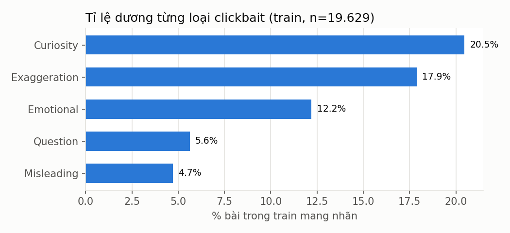 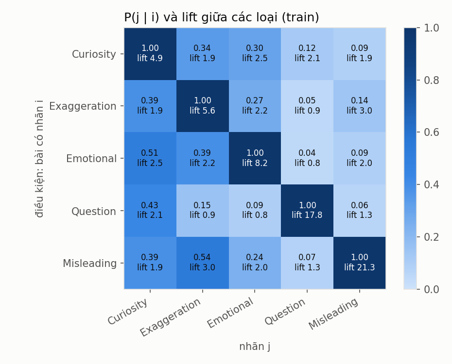

## 2. Giao thức đánh giá (cải tiến so với "chọn trên validation")

1. 5-fold **GroupKFold** trên train theo `leakage_group_id` (bài trùng/gần trùng luôn cùng fold).
2. Mỗi điểm lưới siêu tham số → xác suất out-of-fold (OOF); chọn điểm có **macro AUPRC** OOF cao nhất (không phụ thuộc threshold).
3. Threshold (0,5 cố định / 1 ngưỡng chung / **từng nhãn**) fit trên OOF.
4. Refit trên toàn bộ train → chấm validation **một lần** bằng threshold đã cố định.
5. Báo cáo 95% CI bằng bootstrap **theo nhóm leakage** (1.000 lần) và kiểm định cặp (2.000 lần).

Nhờ vậy số liệu validation là ước lượng held-out thật; OOF Macro-F1 trên train và Macro-F1 validation khớp nhau
(chênh ≤ 0,02, Bảng 1), cho thấy không quá khớp khi chọn mô hình.

## 3. Phân tích dữ liệu và đặc trưng (chỉ trên train)

**Đặc trưng thủ công** (`src/type_classification/features.py`, 33 đặc trưng): độ dài, dấu `? ! … " :`, tỉ lệ chữ hoa,
số trong tiêu đề, **từ điển 5 chiến thuật** (`lexicons.py`, giả thuyết viết từ định nghĩa nhãn), mật độ từ cảm xúc/cường
điệu trong nội dung, và **quan hệ tiêu đề–nội dung** cho Misleading (độ phủ từ tiêu đề trong sapo/đầu bài/toàn bài,
số trong tiêu đề không xuất hiện trong bài, tỉ lệ độ dài tiêu đề/sapo).

- Mann-Whitney U + Benjamini-Hochberg: **123/165** cặp có ý nghĩa (q < 0,001). Mạnh nhất: dấu `?` với Question
  (rank-biserial **+0,83**); tỉ lệ dài tiêu đề/sapo với Curiosity/Exaggeration/Emotional (+0,42 – +0,45); tiêu đề ít trùng
  từ với sapo đi kèm clickbait (−0,37 – −0,38) (hình 3).
- Từ điển (Fisher): bài Question chứa từ hỏi 63,6% so với 9,7% (**OR 16,4**); Emotional OR 6,8; Curiosity OR 4,8;
  Exaggeration OR 2,6 — các giả thuyết đều được xác nhận, mức độ khác nhau.
- **Fightin' Words** (log-odds với prior Dirichlet): ngoài từ chiến thuật ("ngờ, lộ, bất ngờ" – Curiosity; "khóc, bật
  khóc" – Emotional; "gì, nào, vì sao" – Question), xuất hiện **từ chủ đề**: "tôi, chồng, vợ" (bài tâm sự gia đình),
  "con giáp, lộc" (tử vi). → Mô hình có nguy cơ học **thể loại bài** thay vì chiến thuật; được kiểm tra ở mục 8.

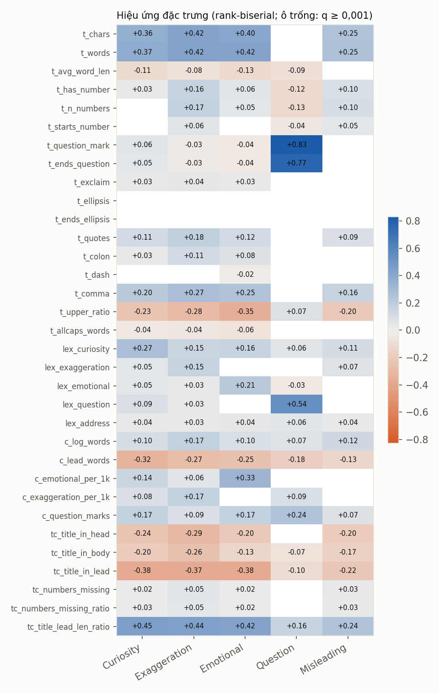
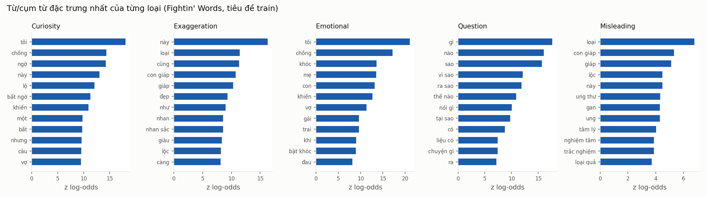

## 4. Mô hình và kết quả (T1.0–T1.5)

| Mã plan | Cấu hình | Ghi chú |
|---|---|---|
| T1.0 | Prior (đoán theo tỉ lệ nhãn); Source-only (chỉ biết báo nào, **chẩn đoán**) | mốc tối thiểu, đo mức "nguồn báo" giải thích nhãn |
| T1.1 | TF-IDF (âm tiết 1–2-gram + ký tự 2–5-gram tiêu đề; 1–2-gram nội dung) + Binary Relevance (LR cân bằng lớp) | tiêu đề / tiêu đề + nội dung |
| T1.2 | Ensemble Classifier Chains (5 chuỗi ngẫu nhiên), Label Powerset (31 tổ hợp), OvR Linear SVM (Platt) | khai thác quan hệ nhãn |
| T1.3 | 33 đặc trưng thủ công + LR / CatBoost | giải thích được |
| T1.4 | Embedding `multilingual-e5-small` của tiêu đề, sapo, nội dung + 3 cosine; LR / CatBoost (+ thủ công) | ngữ nghĩa |
| T1.5 | Ghép tất cả vào 1 LR (early fusion); **Stacking**: mỗi nhãn 1 LR trên logit của 5 mô hình nền × 5 nhãn (late fusion + phụ thuộc nhãn) | kết hợp |

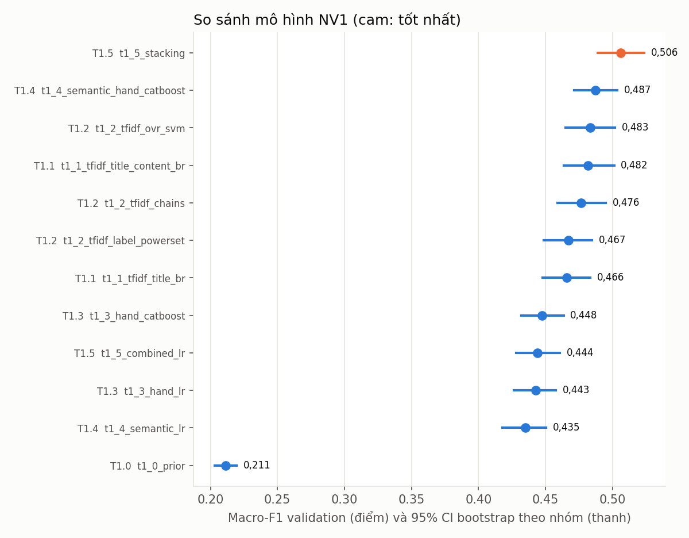

### Bảng 1. So sánh mô hình (threshold từng nhãn chọn trên OOF)

| Mã | Mô hình | Macro-F1 [95% CI] | Micro-F1 | Hamming ↓ | Subset acc | Macro AUPRC | OOF Macro-F1 |
|---|---|---|---:|---:|---:|---:|---:|
| T1.0 | Prior | 0,211 [0,203–0,220] | 0,217 | 0,878 | 0,001 | 0,122 | 0,211 |
| T1.0 | Source-only *(chẩn đoán)* | 0,269 [0,259–0,279] | 0,295 | 0,500 | 0,228 | 0,172 | 0,268 |
| T1.1 | TF-IDF tiêu đề + BR | 0,466 [0,448–0,483] | 0,497 | 0,148 | 0,518 | 0,421 | 0,470 |
| T1.1 | TF-IDF tiêu đề + nội dung + BR | 0,482 [0,464–0,501] | 0,517 | 0,142 | 0,537 | 0,442 | 0,485 |
| T1.2 | Classifier Chains | 0,476 [0,459–0,495] | 0,515 | 0,142 | 0,551 | 0,438 | 0,479 |
| T1.2 | Label Powerset | 0,467 [0,449–0,485] | 0,503 | 0,150 | 0,494 | 0,423 | 0,465 |
| T1.2 | OvR SVM | 0,483 [0,465–0,502] | 0,520 | 0,137 | 0,547 | 0,443 | 0,490 |
| T1.3 | Thủ công + LR | 0,443 [0,426–0,458] | 0,449 | 0,192 | 0,486 | 0,370 | 0,454 |
| T1.3 | Thủ công + CatBoost | 0,448 [0,432–0,463] | 0,465 | 0,170 | 0,506 | 0,393 | 0,462 |
| T1.4 | Semantic + LR | 0,435 [0,418–0,451] | 0,462 | 0,172 | 0,472 | 0,404 | 0,457 |
| T1.4 | Semantic + thủ công + CatBoost | 0,487 [0,471–0,503] | 0,498 | 0,166 | 0,502 | 0,461 | 0,502 |
| T1.5 | Ghép tất cả + LR | 0,444 [0,428–0,461] | 0,481 | 0,163 | 0,490 | 0,416 | 0,460 |
| T1.5 | **Stacking** | **0,506 [0,489–0,524]** | **0,535** | **0,135** | **0,556** | **0,471** | 0,516 |

### Bảng 2. F1 từng nhãn

| Mô hình | Curiosity | Exaggeration | Emotional | Question | Misleading |
|---|---:|---:|---:|---:|---:|
| Prior | 0,340 | 0,303 | 0,217 | 0,106 | 0,090 |
| TF-IDF tiêu đề + BR | 0,547 | 0,503 | 0,501 | 0,597 | 0,181 |
| TF-IDF tiêu đề + nội dung + BR | 0,563 | 0,516 | 0,529 | 0,589 | 0,211 |
| OvR SVM | 0,565 | 0,516 | 0,529 | 0,602 | 0,204 |
| Thủ công + CatBoost | 0,513 | 0,492 | 0,434 | **0,651** | 0,147 |
| Semantic + thủ công + CatBoost | 0,545 | 0,537 | 0,536 | 0,649 | 0,168 |
| **Stacking** | **0,569** | **0,551** | **0,544** | 0,646 | **0,220** |

### Bảng 3. Chiến lược threshold (Macro-F1)

| Mô hình | 0,5 cố định | 1 ngưỡng chung | Từng nhãn |
|---|---:|---:|---:|
| OvR SVM | 0,337 | 0,459 | **0,483** |
| Label Powerset | 0,411 | 0,451 | **0,467** |
| Stacking | 0,465 | 0,498 | **0,506** |
| TF-IDF tiêu đề + nội dung + BR | 0,479 | 0,480 | 0,482 |

Ngưỡng từng nhãn chọn trên OOF **không bao giờ kém** 0,5 cố định; quan trọng nhất với mô hình không cân bằng lớp sẵn
(SVM +0,146, stacking +0,041). Với LR đã `class_weight="balanced"`, 0,5 đã gần tối ưu.

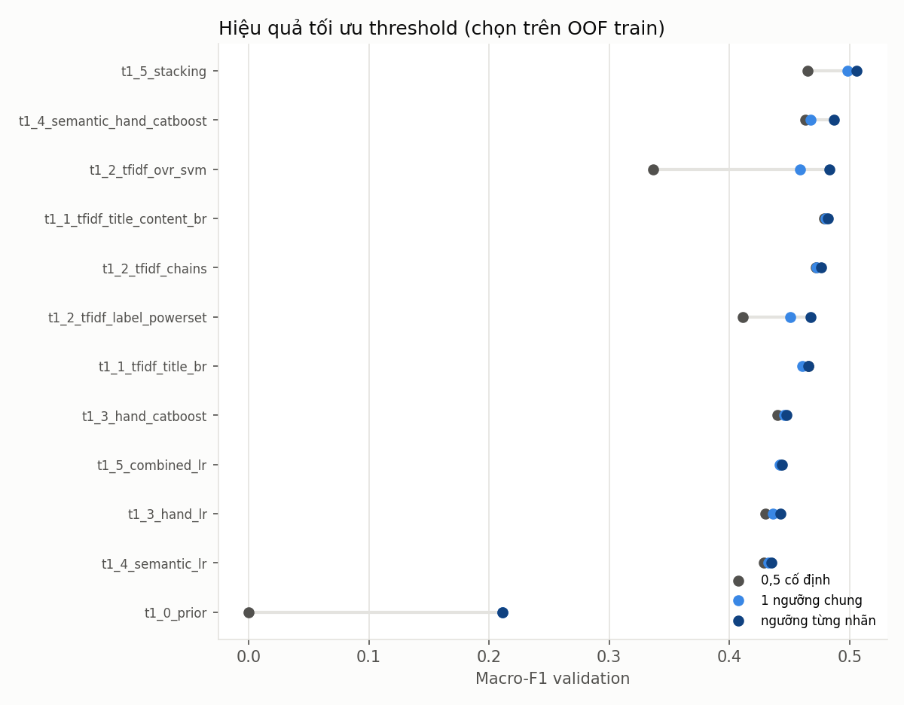 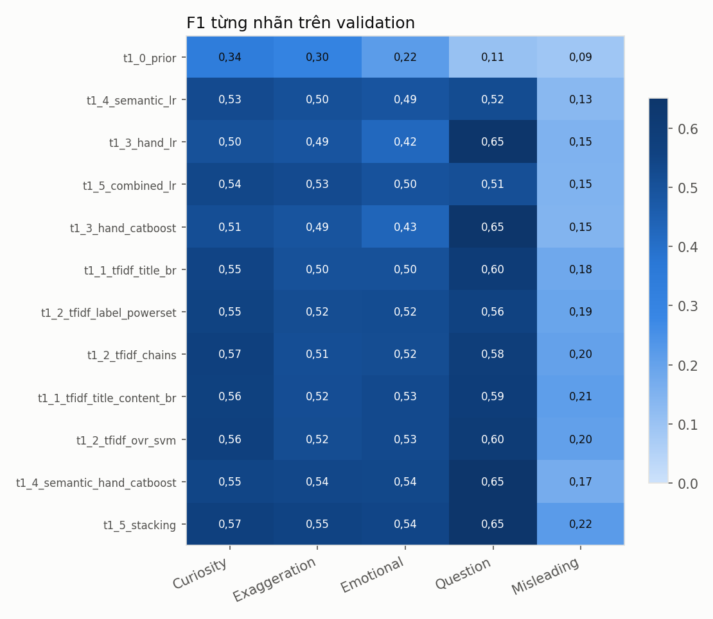

## 5. Kiểm định thống kê giữa các mô hình

### Bảng 4. Bootstrap ghép cặp theo nhóm leakage (2.000 lần)

| So sánh (A − B) | ΔMacro-F1 | 95% CI | p (A không tốt hơn) |
|---|---:|---|---:|
| Stacking − TF-IDF tiêu đề (baseline T1.1) | **+0,040** | [+0,028; +0,051] | < 0,001 |
| Thêm nội dung: TF-IDF tiêu đề + nội dung − tiêu đề | +0,016 | [+0,007; +0,024] | 0,001 |
| Classifier Chains − Binary Relevance | −0,005 | [−0,014; +0,003] | 0,887 |
| Ghép tất cả (early fusion) − TF-IDF tiêu đề + nội dung | −0,038 | [−0,054; −0,022] | 1,000 |
| **Stacking (late fusion) − ghép tất cả** | **+0,062** | [+0,048; +0,075] | < 0,001 |
| Thủ công + CatBoost − Prior | +0,236 | [+0,222; +0,251] | < 0,001 |

Kết luận có ý nghĩa thống kê:

1. **Nội dung bài có ích** nhưng nhỏ (+0,016): chiến thuật clickbait chủ yếu nằm ở tiêu đề.
2. **Classifier Chains không hơn Binary Relevance** dù nhãn đồng xuất hiện mạnh: khi đặc trưng văn bản đã tốt, thông tin
   "nhãn kia" phần lớn đã nằm sẵn trong đặc trưng.
3. **Ghép thẳng các khối đặc trưng làm giảm hiệu năng** (TF-IDF thưa ~400k chiều lấn át 1.200 chiều dày), còn
   **stacking** (mỗi nhóm đặc trưng một mô hình riêng, rồi học cách kết hợp trên logit của mọi nhãn) cho kết quả tốt
   nhất. Đây là cải tiến so với hướng "Combined Features + ML" gợi ý trong plan.
4. Embedding ngữ nghĩa một mình (0,435) **thua** TF-IDF và cả 33 đặc trưng thủ công: clickbait phụ thuộc vào **cách
   viết** (từ ngữ, dấu câu, cấu trúc) hơn là **nghĩa**; nhưng embedding có ích khi kết hợp (CatBoost 0,487, stacking).

## 6. Theo từng nhãn: điều gì mô hình học được

| Nhãn | Mô hình tốt nhất (F1) | Tín hiệu chính (hệ số LR / độ quan trọng CatBoost) |
|---|---|---|
| Question | Thủ công + CatBoost (**0,651**) | dấu `?` chiếm phần lớn độ quan trọng; "gì, nào, sao, tại sao" |
| Curiosity | Stacking (0,569) | "này, lộ, ngờ, thứ, sự thật, bí, lạ"; tiêu đề dài so với sapo, ít trùng từ với sapo |
| Exaggeration | Stacking (0,551) | "sốc, chưa từng, tỷ", dấu ngoặc kép, dấu `:`; tỉ lệ dài tiêu đề/sapo |
| Emotional | Stacking (0,544) | "khóc, nước mắt, sốc, sợ, đau, kinh hoàng"; mật độ từ cảm xúc trong nội dung |
| Misleading | Stacking (**0,220**) | yếu: từ chủ đề ("loại, tâm lý, triệu người") — **nhãn khó nhất** |

- **Question-based "giải được" bằng đặc trưng thủ công**: trả lời trực tiếp câu hỏi nghiên cứu của nhánh "loại nào
  phát hiện được chỉ từ đặc trưng ngôn ngữ".
- **Misleading cần hiểu quan hệ tiêu đề–nội dung**; đặc trưng bề mặt không đủ (F1 ≤ 0,22), và đây cũng là nhãn có chất
  lượng thấp nhất (mục 7) → hướng cho NV2/NV3 (Transformer, multimodal).

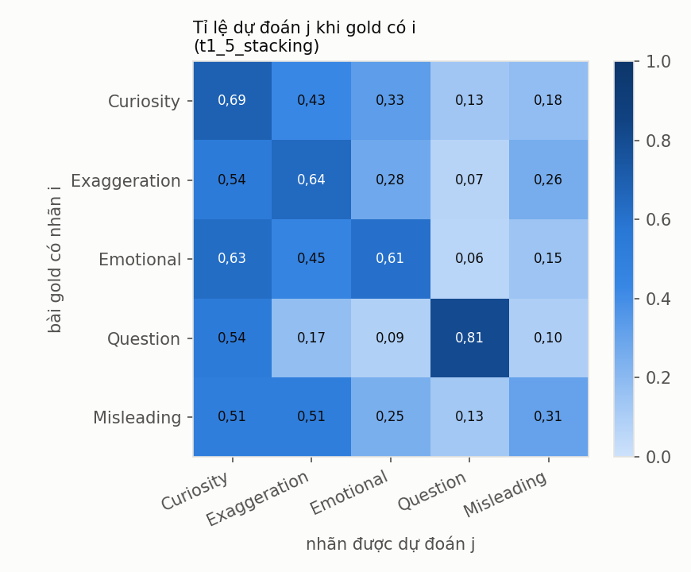

## 7. Chất lượng nhãn: đóng góp cho dữ liệu chung của nhóm

**Độ tin cậy giữa 2 lượt gán AI độc lập** (4.393 bài train có cả `primary` và `blind_review`; 1.143 bài phải phân xử):

| Nhãn | Cohen's κ | Đồng ý thô |
|---|---:|---:|
| Curiosity | 0,62 | 97,4% |
| Emotional | 0,55 | 99,4% |
| Misleading | 0,49 | 97,5% |
| Exaggeration | 0,39 | 99,1% |
| Question | **0,20** | 95,8% |

**Thiên lệch theo pipeline gán nhãn** (χ², p < 1e-9 với mọi nhãn): pipeline nhanh 1 lượt cho Curiosity 25,7%, Exaggeration
23,2%, Emotional 15,7%; pipeline đồng thuận 2 lượt chỉ 3,3%, 0,9%, 0,8%. **Nhưng 20/21 báo chỉ dùng một pipeline**
(Cramér's V nguồn × pipeline = 0,51): chênh lệch "báo nào nhiều clickbait hơn" **không tách được** khỏi chênh lệch do
cách gán nhãn. Không nên kết luận về tỉ lệ clickbait theo nguồn từ dữ liệu hiện tại.

**Confident Learning** (Northcutt et al., 2021) trên xác suất OOF của mô hình tốt nhất:

| Nhãn | % train nghi nhãn sai | Bất đồng 2 lượt gán: bài bị nghi / không bị nghi | Odds ratio |
|---|---:|---|---:|
| Curiosity | 11,6% | 37,1% / 1,9% | 31 |
| Exaggeration | 12,3% | 13,1% / 0,6% | 25 |
| Emotional | 8,4% | 7,8% / 0,5% | 18 |
| Question | 3,6% | 94,1% / 2,1% | 739 |
| Misleading | 19,8% | 23,6% / 1,1% | 27 |

Bài bị Confident Learning nghi ngờ có tỉ lệ bất đồng giữa hai lượt gán **cao gấp hàng chục lần** → phương pháp tìm đúng
các nhãn mơ hồ/sai, không phải nhiễu ngẫu nhiên. Tỉ lệ nghi sai cao nhất ở pipeline nhanh 1 lượt (ví dụ Misleading 24,1%
so với 6,0%). Ví dụ điển hình: tiêu đề là câu hỏi trực tiếp, kết thúc bằng `?`, nhưng bị gán **không** phải
Question-based (ví dụ cụ thể xem hàng đợi rà soát, không đưa tiêu đề bài lên Git). Đã xuất
**hàng đợi rà soát** 10.932 cặp (bài, nhãn) xếp theo mức nghi ngờ để nhóm ưu tiên kiểm tra khi làm gold (lưu ngoài Git
vì chứa tiêu đề bài).

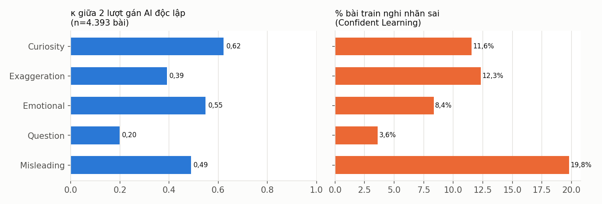

## 8. Độ bền theo nguồn và giá trị của dữ liệu

**Leave-one-source-out** (mô hình TF-IDF tiêu đề + nội dung + BR): bỏ hẳn một báo khỏi train rồi chấm trên bài
validation của báo đó. AUPRC giảm nhiều nhất 0,036 (dantri, chỉ 85 bài val), 0,026 (afamily), 0,023 (tiim), 0,015 (soha), 0,014
(eva), 0,013 (kenh14); 9/15 báo giảm dưới 0,01 hoặc tăng. → Mô hình phần lớn học **tín hiệu chuyển giao được** giữa các báo. Mô hình chỉ biết
nguồn đạt 0,269 Macro-F1 — có thông tin nhưng xa mức 0,506 của stacking.

**Learning curve**: AUPRC macro 0,355 (1.967 bài) → 0,422 (9.827) → 0,442 (19.629). Lợi ích giảm dần; Question tăng
mạnh nhất (0,32 → 0,49), Misleading thấp và tăng chậm (0,09 → 0,14) → với Misleading, **nhãn tốt hơn và đặc trưng ở mức
nội dung** quan trọng hơn thêm số lượng.

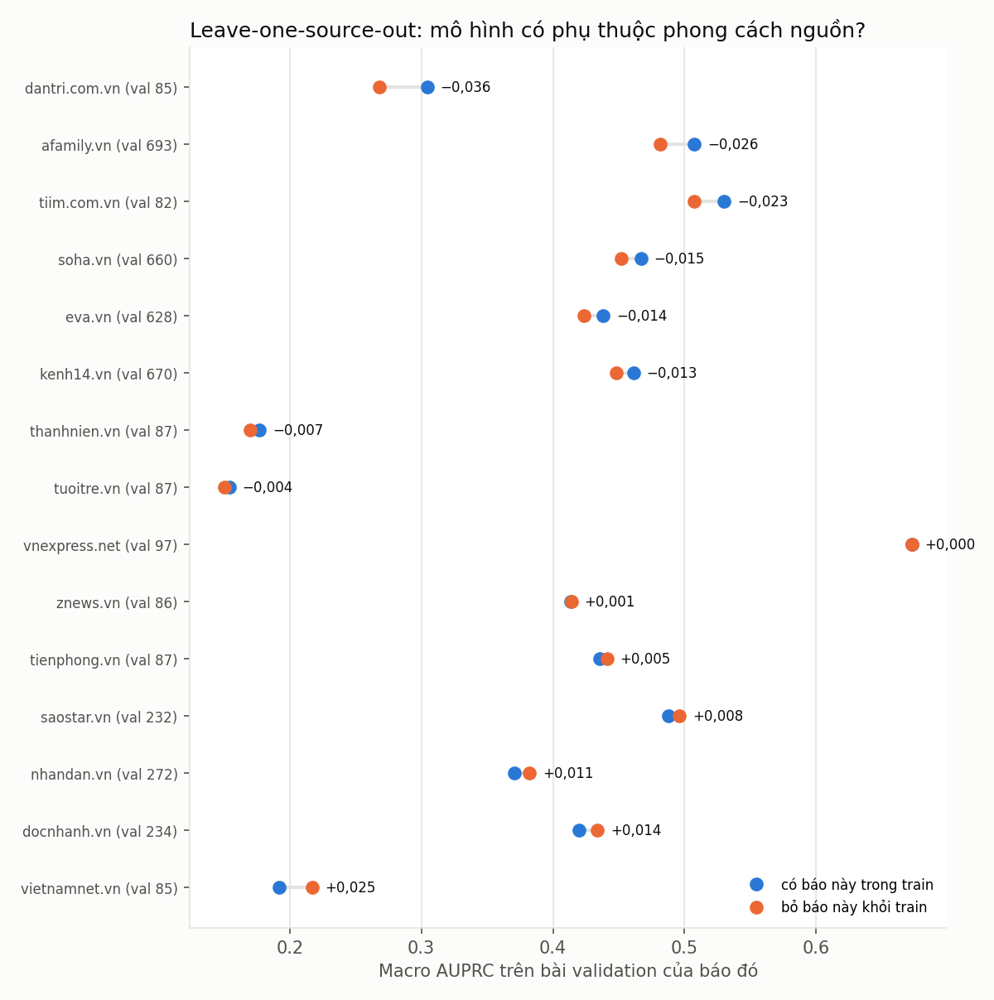 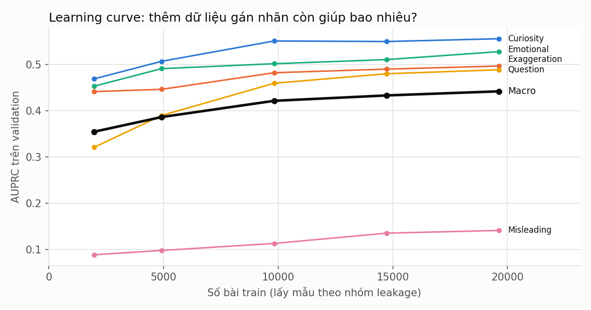

## 9. Ràng buộc Detection–Type và lỗi

- Suy ra Detection từ Type (có ≥ 1 Type ⇒ clickbait): F1 0,726. Tỉ lệ vi phạm logic: dự đoán có Type trên bài gold
  non-clickbait **23,1%**; không Type nào trên bài gold clickbait 22,3%. Khi ghép với mô hình Detection của Nhánh 1, nên
  báo `detection_type_conflict` theo contract thay vì sửa điểm.
- Lỗi thường gặp: dương tính giả ở bài sức khoẻ/tử vi dạng liệt kê (con giáp, thực phẩm "trường thọ") cho Misleading
  — nhiều trường hợp chính là **nhãn còn thiếu** (mục 7); âm tính giả ở tiêu đề tin thời sự bị gán nhãn chiến thuật.

## 10. Hạn chế và đề xuất

- Nhãn là pseudo-label; test gold chưa có → mọi kết luận là trên validation pseudo. Khi có gold, chạy lại cùng script.
- Snapshot `data.csv` dựng lại từ `GĐ3/Labeled_data/data.csv` (SHA khớp `source_sha256` của manifest) + split chính
  thức; phân bố nhãn khớp 126/126 ô với `split_distribution.csv`, nhưng byte file khác bản đóng gói chính thức.
- **Đề xuất cho nhóm**: (1) gán lại một **mẫu cầu nối** cùng bài bằng cả hai pipeline (hoặc người) để hiệu chỉnh chênh
  lệch; (2) dùng hàng đợi Confident Learning để ưu tiên rà soát gold; (3) Misleading cần mô hình đọc hiểu quan hệ
  tiêu đề–nội dung (NV2/NV3).

## 11. Tái lập

```bash
python scripts/type_nv1_features.py --dataset-root ../data_pr/dataset_v1.0 --out ../data_pr/nv1_cache --embeddings
python scripts/type_nv1_eda.py --dataset-root ../data_pr/dataset_v1.0 --cache ../data_pr/nv1_cache
python scripts/train_type_nv1.py --config configs/type_nv1/experiments.yaml --dataset-root ../data_pr/dataset_v1.0 --cache ../data_pr/nv1_cache
python scripts/report_type_nv1.py --dataset-root ../data_pr/dataset_v1.0
python scripts/type_nv1_insights.py --dataset-root ../data_pr/dataset_v1.0 --cache ../data_pr/nv1_cache --queue ../data_pr/nv1_review_queue.csv
python -m pytest tests/research -q
```

Artifact mỗi run theo `docs/RESEARCH_CONTRACTS.md` (ngoài Git): `experiments/<run_id>/{config.yaml, run.json,
events.jsonl}`, `results/<run_id>/{metrics.json, predictions.jsonl, oof_probs.npy, val_probs.npy}`,
`checkpoints/<run_id>/{model.joblib, provenance.json}` (mô hình sklearn; chỉ nạp file tin cậy). Bảng số liệu đầy đủ:
`nv1/results_tables.md`, `nv1/eda.json`.
